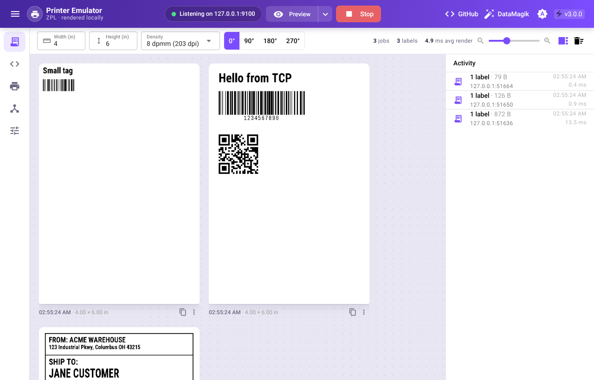
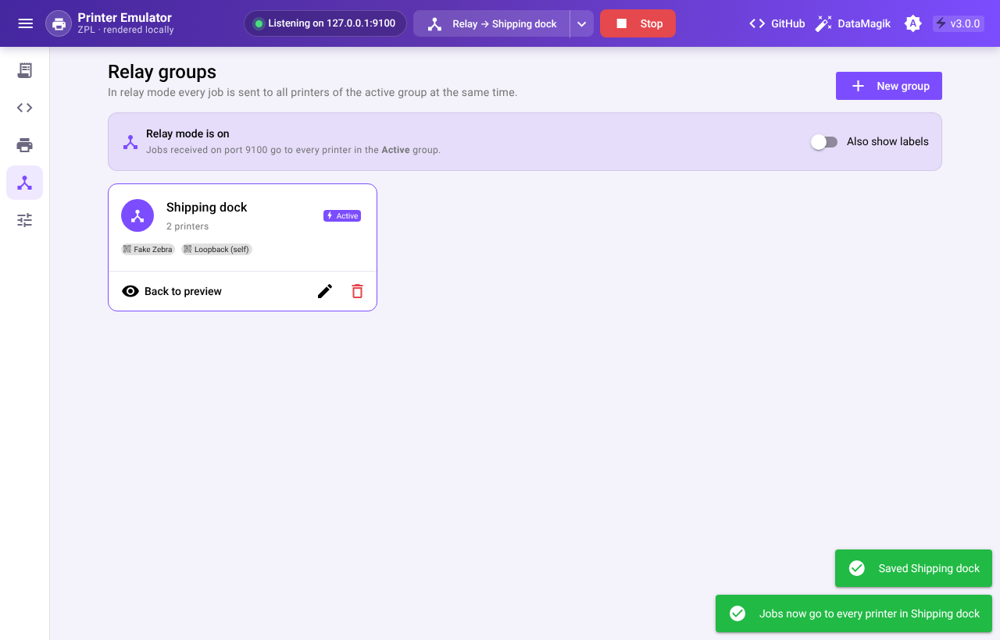
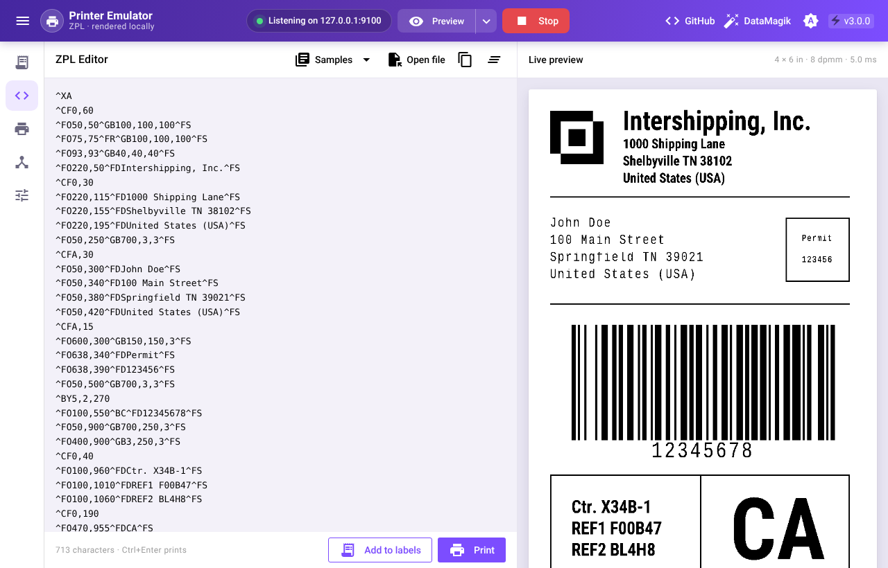
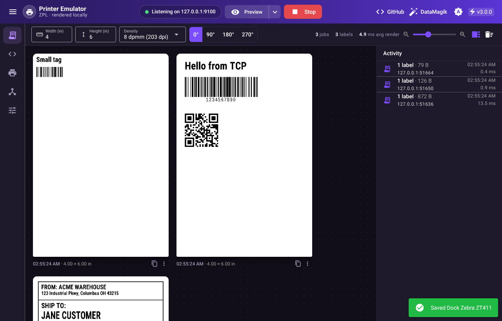

# ZPL Printer Emulator

A desktop app that acts like a Zebra ZPL printer. Point a Zebra driver, or any app that prints raw ZPL, at it and every label appears on screen. It can also forward jobs to a real printer or relay them to a group of printers.

Version 3 draws labels **on your computer** with [DataMagik ZPL-To-Image](https://github.com/dchupp/DataMagik-ZPL-To-Image). Nothing is sent to an online service, it works offline, and a typical label renders in a few milliseconds.



## Features

- **Preview**: each label appears as soon as its `^XZ` arrives, even if the sender keeps the connection open. Zoom, open a label full size, see the job's ZPL and any render warnings, copy the image, save it as PNG, or send it to a network printer.
- **Forward**: send every job to one network printer.
- **Relay**: send every job to all printers in a group at the same time.
- **Network printers**: Zebra printers receive the raw ZPL on port 9100. Any IPP printer receives the label as a PDF at the label's exact size, with PNG as a fallback.
- **ZPL editor**: live preview as you type, sample labels, open `.zpl` files, and print through the same path as a job from the network.
- **Printer memory**: graphics, formats and fonts a job stores (`~DG`, `^DF`, `~DU`…) stay available to later jobs, as on a real printer. Reset it from Settings.
- **Driver friendly**: answers the `~HS` and `~HI` status queries, so drivers that poll the printer don't hang.
- Label sizes in fractions of an inch, 6/8/12/24 dpmm (152–600 dpi), rotation, and optional expansion of `^PQ` copies.
- Save every label (and optionally its ZPL) to a folder, open at login, start the printer when the app opens, keep running in the tray, accept jobs from other computers, light or dark theme.

## Install

1. Download the app from the [releases page](https://github.com/dchupp/printerEmulator/releases/).
2. Install a Zebra ZPL driver. The easiest way is [Zebra Setup Utilities](https://www.zebra.com/us/en/support-downloads/printer-software/printer-setup-utilities.html). Any ZPL driver from Zebra works.
3. Add a network printer at **IP address `127.0.0.1`, port `9100`** using that driver ([Zebra's guide](https://supportcommunity.zebra.com/s/article/Adding-a-networked-Zebra-Printer-to-a-Windows-10-PC?language=en_US)).
4. Open the emulator, set the label size and density, and press **Start**.

## Using it

### Choose what happens to a job

The mode menu in the header decides what the emulator does with each job it receives:

| Mode | What happens |
|---|---|
| **Preview** | Labels are shown on the Labels page (and saved to disk if you turned that on). |
| **Forward** | The job goes to one network printer. Pick it with **Forward here** on the Network printers page. |
| **Relay** | The job goes to every printer in a relay group at once. Pick the group with **Relay to this group**. |

In Forward and Relay mode, turn on **Also show labels** to preview the labels as well. The activity log on the Labels page shows each job and whether it reached each printer.



### Try ZPL without a driver

Open the **ZPL editor** to type or paste ZPL and see it rendered as you type. **Add to labels** puts the result in the label list; **Print** handles it exactly like a job from the network, so it is forwarded or relayed in those modes.



You can also send ZPL straight to the port from a terminal:

```sh
# macOS / Linux
printf '^XA^FO50,50^A0N,50^FDHello^FS^XZ' | nc 127.0.0.1 9100
```

```powershell
# Windows PowerShell
$c = New-Object Net.Sockets.TcpClient('127.0.0.1', 9100)
$s = $c.GetStream(); $b = [Text.Encoding]::ASCII.GetBytes('^XA^FO50,50^A0N,50^FDHello^FS^XZ')
$s.Write($b, 0, $b.Length); $c.Close()
```

### Print from other computers

Turn on **Settings → Accept jobs from other computers**, then point other computers at this computer's IP address and the same port. Your firewall may ask to allow the app.

### Upgrading from 2.x

Your settings, network printers and relay groups are imported the first time version 3 starts. An existing "start at login" setting keeps working. Relay groups get default names (Group 1, Group 2…), which you can rename.

## Troubleshooting

- **"Port 9100 is already in use"**: another program, or a second copy of the emulator, is using the port. Close it, or choose another port in Settings and point your driver at that port.
- **Labels are cut off or too small**: set the label width, height and density to match the label your software is designed for. The size given in the emulator is used even when the ZPL sets `^PW`/`^LL`.
- **A label looks slightly different from the printer**: Zebra's fonts are proprietary, so close open-source look-alikes are used. Open the label to see any render warnings.
- **Forwarded jobs fail**: use **Check connection** on the printer's card. Zebra printers need port 9100 open; IPP printers usually use port 631 and the path `/ipp/print`.
- **Nothing appears in Forward or Relay mode**: that's expected; labels are only previewed in those modes when **Also show labels** is on.



## Develop

Requirements: Go 1.26+, Node 20+, and the Wails 3 CLI:

```sh
go install github.com/wailsapp/wails/v3/cmd/wails3@v3.1.0
wails3 doctor        # checks platform dependencies (WebView2 / WebKitGTK)
```

```sh
wails3 dev           # run with hot reload
wails3 build         # build for this OS into bin/
wails3 package       # installer: NSIS on Windows, .app on macOS, AppImage/deb/rpm on Linux
go test ./...        # backend tests (TCP server, rendering, forwarding, IPP, PDF, storage)
```

The frontend is Vue 3 + Quasar on Vite (`frontend/`). The files in `frontend/bindings` are generated by `wails3 generate bindings`; the build tasks regenerate them.

### Layout

| File | Purpose |
|---|---|
| `main.go` | Window, tray menu, single instance |
| `service.go` | `EmulatorService`: everything the UI calls, and the job pipeline |
| `server.go` | Raw TCP print server (port 9100) |
| `render.go` | ZPL → PNG with a persistent virtual printer |
| `forward.go` | Raw ZPL forwarding, IPP Print-Job, label PDF |
| `history.go` | In-memory label history, served to the UI at `/labels/{id}.png` |
| `store.go`, `models.go` | SQLite storage and types |
